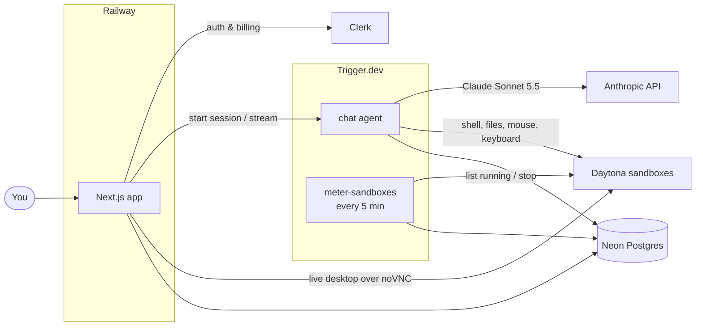

<div align="center">

# Shiftbot

### AI teammates that take a shift for you

Give a bot a job, and it does the work on a computer of its own: it runs commands, edits files, clicks through apps, and remembers what you told it.

[](https://nextjs.org)
[](https://www.anthropic.com)
[](https://trigger.dev)
[](https://daytona.io)
[](https://clerk.com)
[](https://neon.tech)
[](https://railway.com)

</div>

---

Most AI assistants stop at telling you how to do something. A Shiftbot teammate does it. Each bot you create gets its own private Linux machine in the cloud, with a terminal, a filesystem and a full graphical desktop. Ask for a report and it researches and writes the file. Ask it to try something in a browser and you can watch the mouse move.

Bots keep their job, instructions and memory in every conversation, so you set them up once and pick up where you left off. Put several in a group chat and they pass work to whichever teammate is best suited to it.

## ✨ What you can do

- 🧑‍💼 **Create teammates with a job.** Give each bot a name, a face, a job and standing instructions. Start from a template (Research assistant, Code reviewer, Writing editor, Tutor) or write your own.
- 🖥️ **Give every bot its own computer.** Each bot owns a persistent, isolated Linux sandbox. It can run shell commands, read and write files, and operate a desktop with the mouse and keyboard.
- 👀 **Watch it work.** Open a bot's desktop next to the chat and see it live, or ask the bot to show you a screenshot of its screen.
- 👥 **Run group chats.** Add several bots to one chat, choose which bot each message is for, and let a bot hand a request to the teammate whose job it is. A request is handed off at most once, so bots never pass it back and forth.
- 🧠 **Count on memory across chats.** Bots save what matters (your preferences, decisions, ongoing work) and remember it in every conversation, direct or group.
- ♾️ **Rely on durable conversations.** Long, multi-step tasks keep running through page refreshes, redeploys and closed tabs. Come back and the reply is there.
- 🔎 **Find past chats fast.** Search across conversations from the sidebar with a keyboard shortcut.
- 📊 **See your usage.** A usage page shows AI spend, sandbox hours and bot count for the current billing period, with a countdown to the reset.
- 🌗 **Use light or dark mode.** The interface follows your system theme.

## 💳 Plans

Shiftbot runs on a **Pro** subscription, managed through Clerk Billing. Each billing period includes:

| Allowance           | Pro                      |
| ------------------- | ------------------------ |
| AI usage            | $8 of model spend        |
| Sandbox time        | 30 hours of running time |
| Bots at once        | 5                        |

When AI usage runs out, bots stop replying until the period resets. When sandbox time runs out, running computers are switched off and bots keep chatting without their computer tools. Free accounts can sign in and browse plans, but creating bots and chatting with them needs Pro.

Limits are defined in [`lib/usage.ts`](lib/usage.ts) and are easy to change.

## 🔍 How it works



- **A chat turn** runs as a durable Trigger.dev agent ([`trigger/chat.ts`](trigger/chat.ts)). It loads the bot's job, instructions and memory, then streams a reply from Claude with the computer tools attached ([`trigger/tools.ts`](trigger/tools.ts)). A turn can take up to 50 steps and stops early if the AI allowance is spent.
- **The computer** is a Daytona sandbox created along with the bot and deleted with it ([`lib/sandbox.ts`](lib/sandbox.ts)). It starts only when a tool needs it. The bot's memory lives in a `MEMORY.md` file in its home directory.
- **Group chats** give the answering bot a `handoff` tool, which passes the rest of the turn to a teammate who answers on their own computer.
- **Usage** is an append-only ledger. Each model call is recorded as it finishes. Every five minutes a scheduled task charges running sandboxes to their owners and stops those of users who are out of sandbox time ([`trigger/meter-sandboxes.ts`](trigger/meter-sandboxes.ts)).

### Bot tools

| Tool                                                       | What it does                                         |
| ---------------------------------------------------------- | ---------------------------------------------------- |
| `bash`                                                     | Run a shell command in the sandbox                   |
| `read_file`, `write_file`, `list_files`                    | Work with files on the sandbox's disk                |
| `mouse_click`, `mouse_move`, `mouse_drag`, `mouse_scroll`  | Operate the desktop with the mouse                   |
| `keyboard_type`, `keyboard_press`                          | Type text and press keys or shortcuts                |
| `view_screen`                                              | Take a private screenshot to check the screen        |
| `show_screen`                                              | Show a screenshot of the desktop to you              |
| `save_memory`                                              | Update the memory the bot carries across chats       |
| `handoff`                                                  | Pass a group-chat request to a better-suited bot     |

## 🧱 Built with

| Product                                | Role in Shiftbot                                                         |
| -------------------------------------- | ------------------------------------------------------------------------ |
| [Anthropic](https://www.anthropic.com) | Claude Sonnet 5.5 powers every bot                                       |
| [Trigger.dev](https://trigger.dev)     | Runs the durable chat agent and the sandbox metering cron                |
| [Daytona](https://daytona.io)          | One cloud sandbox per bot, with shell, files and a controllable desktop  |
| [Clerk](https://clerk.com)             | Sign-in, plus Billing for plans, checkout and feature gates              |
| [Neon](https://neon.tech)              | Serverless Postgres for bots, chats and the usage ledger                 |
| [Railway](https://railway.com)         | Hosts the Next.js app in production                                      |

Also: Next.js 16, React 19, AI SDK 7, AI Elements, shadcn/ui, Tailwind CSS 4, Drizzle ORM and DiceBear avatars.

## 🛠️ Self-hosting

### Requirements

- Node.js 20.12 or newer
- Accounts with [Clerk](https://clerk.com), [Neon](https://neon.tech), [Trigger.dev](https://trigger.dev), [Daytona](https://daytona.io) and [Anthropic](https://console.anthropic.com)

### Environment

Create `.env.local` in the project root:

```bash
# Clerk
NEXT_PUBLIC_CLERK_PUBLISHABLE_KEY=
CLERK_SECRET_KEY=
NEXT_PUBLIC_CLERK_SIGN_IN_URL=/sign-in
NEXT_PUBLIC_CLERK_SIGN_UP_URL=/sign-up
NEXT_PUBLIC_CLERK_SIGN_IN_FALLBACK_REDIRECT_URL=/
NEXT_PUBLIC_CLERK_SIGN_UP_FALLBACK_REDIRECT_URL=/

# Neon: pooled connection string for the app, direct one for drizzle-kit
DATABASE_URL=
DATABASE_URL_UNPOOLED=

# Anthropic
ANTHROPIC_API_KEY=

# Trigger.dev: the development secret key
TRIGGER_SECRET_KEY=

# Daytona
DAYTONA_API_KEY=
```

### Billing

In the Clerk dashboard, enable Billing and create a user plan with the slug `pro`. Give it two features, slugged `bots` and `sandboxes`.

### Run locally

```bash
npm install
npm run db:push               # create the database tables
npm run dev                   # terminal 1: the Next.js app
npx trigger.dev@4.8.3 dev     # terminal 2: the chat agent and metering task
```

Open [http://localhost:3000](http://localhost:3000), sign up, subscribe to Pro, and create your first teammate.

### Deploy

The app and the background tasks deploy separately.

1. **App:** deploy to [Railway](https://railway.com) (or any Node host) with the variables above. Use your Trigger.dev **production** secret key for `TRIGGER_SECRET_KEY`.
2. **Tasks:** deploy them to Trigger.dev:

   ```bash
   npx trigger.dev@4.8.3 deploy
   ```

3. **Task variables:** add these to the Trigger.dev project's production environment:

   ```bash
   DATABASE_URL=
   CLERK_SECRET_KEY=
   DAYTONA_API_KEY=
   ANTHROPIC_API_KEY=
   ```

## 📁 Project layout

```
app/          Pages: chats, pricing, usage, sign-in and sign-up
actions/      Server actions for bots and chats
components/   Chat UI, bot and group dialogs, desktop panel, sidebar
db/           Drizzle schema and database client
lib/          Sandbox access, billing gates and usage metering
queries/      Read queries for bots and chats
trigger/      The chat agent, its tools and the metering task
```

## 🤝 Contributing

Issues and pull requests are welcome. Before opening one, run:

```bash
npm run lint
npm run typecheck
npm run format
```
